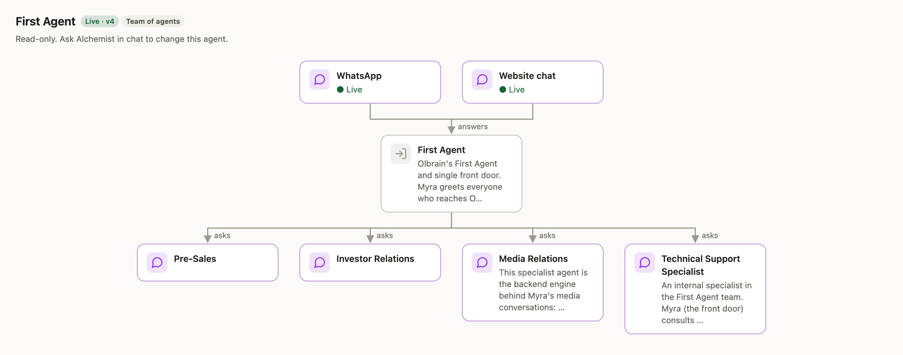
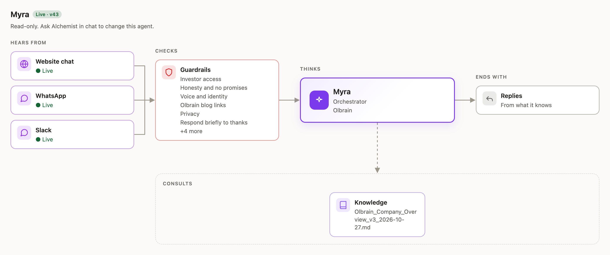

<p align="center">
  <picture>
    <source media="(prefers-color-scheme: dark)" srcset="assets/olbrain-mark-light.png">
    
  </picture>
</p>

<h1 align="center">Alchemist</h1>

<p align="center"><code>OLBRAIN · AGENT BUILDER</code></p>

<p align="center">
  Build, test and publish <a href="https://olbrain.com">Olbrain</a> AI agents from Claude Code, Codex or claude.ai.<br>
  You describe the agent. Claude plans it with Alchemist's guidance; Alchemist builds it, tests it, checks every step — and asks you before anything goes live, unless you let Claude decide.
</p>

<p align="center">
  <a href="#install"></a>
  <a href="#codex"></a>
  <a href="#claudeai-and-claude-code-on-the-web"></a>
  <a href="https://alchemist.olbrain.com/mcp/"></a>
</p>

<p align="center">
  <a href="#install">Install</a> ·
  <a href="#how-a-build-works">How a build works</a> ·
  <a href="#capabilities">Capabilities</a> ·
  <a href="#commands-and-tools">Tools</a> ·
  <a href="#privacy-and-security">Privacy</a> ·
  <a href="https://docs.olbrain.com">Docs</a>
</p>

---

## What it is

Alchemist is Olbrain's agent builder, available as an MCP server and a Claude Code plugin.
You tell Claude what the agent should do, in plain words. Claude (or Codex) plans and
designs the agent from your words and your project, with Alchemist's step-by-step guidance.
Alchemist builds it in your Olbrain organisation, tests it on real inputs, checks each step
in order, refusing one that is skipped, and publishes it.

Every agent it builds runs on Olbrain and stays visible in
[Noesis](https://noesis.olbrain.com), Olbrain's console, where your team can open, review
and change it.

<p align="center">
  <picture>
    <source media="(prefers-color-scheme: dark)" srcset="assets/diagram-team-dark.png">
    
  </picture>
  <br>
  <sub>Olbrain's own front door, built with Alchemist: one team of agents on WhatsApp and website chat.</sub>
</p>

## Install

### Claude Code

```
/plugin marketplace add Olbrain/alchemist-plugin
/plugin install alchemist@alchemist
```

Then run `/mcp`, pick **alchemist** and sign in with your Olbrain account. New to Olbrain?
Choose **Create account** on the sign-in page.

Claude Code asks before every tool call. To stop it asking each time Claude checks on a
build, allow the five read-only tools once under `/permissions`:
`mcp__plugin_alchemist_alchemist__whoami`, `mcp__plugin_alchemist_alchemist__alchemist_builds`,
`mcp__plugin_alchemist_alchemist__alchemist_build`,
`mcp__plugin_alchemist_alchemist__alchemist_capabilities` and
`mcp__plugin_alchemist_alchemist__alchemist_state`. Leave the rest asking, including
`alchemist_do` and `alchemist_answer`: they take build steps, answer cards or change your
organisation.

To see an agent drawn in a pane beside the chat, also install the canvas:

```
/plugin install alchemist-canvas@alchemist
```

It draws the agent whenever Claude shows it, and redraws it when a publish or make-live
card arrives, with new, changed and removed parts marked. `/agent-canvas` opens the pane
when the terminal is too narrow for it to open by itself. It needs a Claude Code build
with plugin panes; older builds and Codex skip it.

### Codex

```
codex mcp add alchemist --url https://alchemist.olbrain.com/mcp/
codex mcp login alchemist
```

Optional: copy `plugins/alchemist/skills/alchemist` to `~/.agents/skills/alchemist` so Codex
follows the same workflow as Claude, including when to continue a build and when to start a
new one. Without it, the server's own instructions carry the same rule. A copied skill does
not update itself: copy it again after each release (0.9.0 changes how builds run).

### claude.ai and Claude Code on the web

Add a custom connector with the URL `https://alchemist.olbrain.com/mcp/`
(Customize → Connectors → Add custom connector; on Team and Enterprise plans an owner adds it
under Organization settings → Connectors). Then click **Connect** and sign in.

## How a build works

| Stage | What happens | Your call |
| --- | --- | --- |
| `01`&nbsp;Brief | Your coding agent drafts what you asked for (who the agent serves, what it does, what it must not do) from your words and your project; Alchemist checks it. | Approve or change it |
| `02`&nbsp;Plan | Your coding agent drafts the agents, steps, channels and tools; Alchemist checks it. | Approve or change it |
| `03`&nbsp;Build | Alchemist builds the agent, connects its tools and knowledge, and reviews the setup for gaps and contradictions. | Sign in to tools or add keys when a card asks |
| `04`&nbsp;Test | Your coding agent writes the tests; Alchemist checks them, runs them on the draft and grades them. A job gets a live run on a real input first. | Run the live test, or not yet |
| `05`&nbsp;Publish | The tested version is published, with a 30-day free trial for a new agent. | Publish, or not yet |
| `06`&nbsp;Go&nbsp;live | Embed code, API and SDK steps, or the channel it answers on. | You run the commands |

Alchemist gives one stage at a time and refuses a step taken out of order. Builds started in
Noesis, and plugin builds while Olbrain moves accounts over, are still planned by Alchemist's
own model through the `alchemist` tool; the skill switches by itself.

On a build Claude plans, each agent has a budget: six passes per fix round, a stop after
three passes in a row without a gain, four failed compiles and 120 draft test runs. When a
build reaches one, Claude shows the best result so far and asks whether to continue (two
more passes). A stronger model usually gets a build through its tests first time.

Before Alchemist publishes an agent, makes it live, merges agents or changes how one behaves,
it stops with an **approval card**. You decide how many of these Claude answers for you:
tell it in the chat, or put it in your `CLAUDE.md` or `AGENTS.md`, for example *"Approve
plans and tests yourself; ask me before publishing."* If you haven't said, Claude answers
every card itself in auto mode (Codex: running without approvals) and asks you otherwise.
It still asks for what only you can do, like sharing a Drive folder or a browser step.
On a build Claude plans, removing an agent, forgetting a customer, renaming or moving an
agent, changing a job's email address, and publishing despite failing tests are always
answered in the browser, from the link Claude gives you.
If Claude Code blocks an answer, answer the card on its build page, or allow the tool with
`/permissions`: `mcp__plugin_alchemist_alchemist__alchemist_answer` when installed as the plugin,
`mcp__claude_ai_Alchemist__alchemist_answer` when added as a claude.ai connector.

## Use it

- Ask in plain words: *"Use Alchemist to build an agent that answers questions about our
  pricing and hands refunds to a person."*
- `/alchemist:build <what the agent should do>` starts a build.
- `/alchemist:status` shows your account, organisation, builds and any cards waiting on you.
- *"Pick up my support agent build"*: Claude finds your build by name and carries on. Builds are
  private to you; a teammate changes your published agent in a new build of their own. Anything
  waiting on you comes first, and Claude doesn't start a duplicate.
- *"Put my support agent on my website"* or *"call my intake job when our signup form is
  sent"*: Claude adds the chat snippet, or a server route that calls the agent, to your
  project. It never puts your API key in browser code.
- *"Show me my support agent"*: Claude draws it as a read-only diagram (example below).
- *"What can Alchemist do?"* or *"Can it answer calls on our phone number?"*: Claude checks
  the live capability list before saying yes or no.
- *"Where is my ticket TKT-…?"* or *"Raise a ticket: our webhook job didn't run"*: Alchemist
  handles your Olbrain support tickets in the same session.

<p align="center">
  <picture>
    <source media="(prefers-color-scheme: dark)" srcset="assets/diagram-chat-dark.png">
    
  </picture>
  <br>
  <sub>A chat agent's diagram: where it hears from, what it checks, what it consults and how it ends.</sub>
</p>

## Capabilities

Ask Claude *"What can Alchemist do?"* for the full, current list: it reads
`alchemist_capabilities` live, so it is never out of date.

You don't pick a type of agent. Describe the work; Alchemist decides.

| Agent | What it is |
| --- | --- |
| **Chat agent** | One person talks to it, turn by turn, in chat or by voice. |
| **Automatic job** | Runs by itself with nobody talking to it. Steps can wait hours or days, stop for a named person's approval (with reminders), call APIs and tools, and notify people. |
| **Team of agents** | One front door hands each question to the specialist that owns it, and can start automatic jobs. Customers reach it on website chat or WhatsApp. |
| **Research agent** | A person asks for a report in Noesis; it researches the sources and emails the report. A scheduled job can run it too. |

A job starts on a schedule, a webhook (Stripe, Shopify, GitHub and other signed senders), an
email, a team's front door, or a new file in a Google Drive, cloud storage bucket, Dropbox or
OneDrive folder. Agents answer on website chat, WhatsApp, Shopify storefront chat, your phone
number and Microsoft Teams. They use tools from Olbrain's connector catalog, any REST API or
your own MCP server, and answer from their knowledge files. Every agent gets a setup review
and tests before it publishes. Anything Alchemist can't build yet goes to the Olbrain team as
a request, with an id you can follow up on.

## Commands and tools

| Command | What it does |
| --- | --- |
| `/alchemist:build <description>` | Start a build |
| `/alchemist:status` | Your account, organisation, builds and waiting cards |

| Tool | What it does |
| --- | --- |
| `whoami` | Who you are signed in as, and your organisations |
| `create_org` | Create an organisation and make it active |
| `select_org` | Switch your active organisation (everywhere you are signed in) |
| `list_members` | Who is in your organisation |
| `alchemist` | Start a build or add your words to one; on builds Alchemist's own model runs, one builder turn |
| `alchemist_state` | Where a build stands: its stage, the steps allowed next, waiting cards, budget and news. Read-only |
| `alchemist_do` | Take one allowed build step (write the brief, build, write tests, run them, raise a card) |
| `alchemist_answer` | Send your choice on an approval card |
| `alchemist_builds` | List your builds, each with a state (running, needs you, stale, in progress, inactive, completed, published, archived, idle) and a readable label |
| `alchemist_build` | One build: its plan, agents, waiting cards and next step; with `wait`, follows a running turn and says what Alchemist, Cortex and Synapse did |
| `alchemist_edit_build` | Rename a build, or archive it (and bring it back), with an optional reason |
| `alchemist_rate_build` | Rate how a build session went (up or down, with an optional comment) |
| `alchemist_stop` | Stop the turn a build is running |
| `alchemist_connect` | Put a live agent on your website or call it from your code |
| `alchemist_capabilities` | What Alchemist can build and do, read live |
| `alchemist_show_agent` | One agent, or one of its published versions, as a read-only diagram |

Inviting people and joining an organisation happen in [Noesis](https://noesis.olbrain.com).
Every build can also be opened there.

## Privacy and security

- Every tool call goes to `https://alchemist.olbrain.com`, which acts as you in Olbrain. It
  keeps your Olbrain sign-in encrypted so you stay signed in; remove the connection to end it.
- Keys and passwords for tools never pass through the chat. Approval cards collect them into
  your organisation's vault.
- Nothing goes live, merges or changes behaviour without an approval card you answered.
  Claude Code also asks your permission before sending each answer.
- Draft test runs, probes and compiles are counted per developer per day, to keep builds
  within their budget. Pricing does not change.
- Once an agent is live, its go-live steps call Olbrain's agent API at
  `https://webhook.olbrain.com` with your organisation's API key — to test it, upload a file
  for a job, start a job, or from the server route Claude adds to your app. You run those
  commands yourself, and the key stays in your own environment.

Olbrain's [privacy policy](https://olbrain.com/privacy.html) and
[terms](https://olbrain.com/terms.html).

## Links

[olbrain.com](https://olbrain.com) · [Noesis](https://noesis.olbrain.com) ·
[Docs](https://docs.olbrain.com) · [Developers](https://olbrain.com/developers/) ·
[Support](https://olbrain.com/contact/)

## Licence

Copyright Olbrain. All rights reserved.
